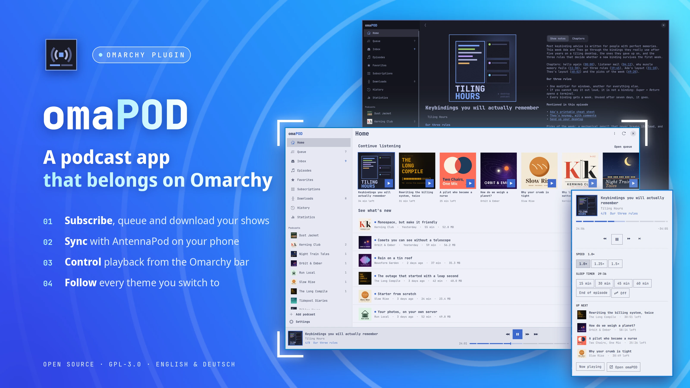
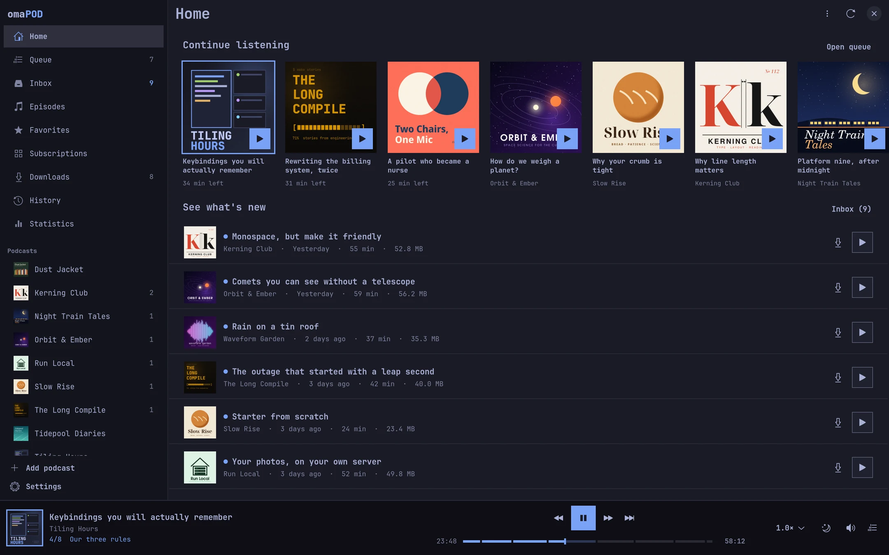
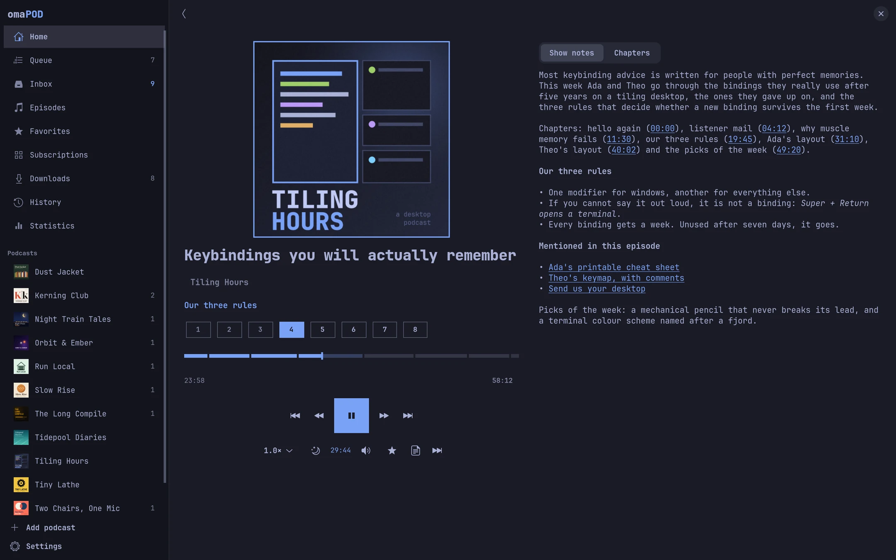
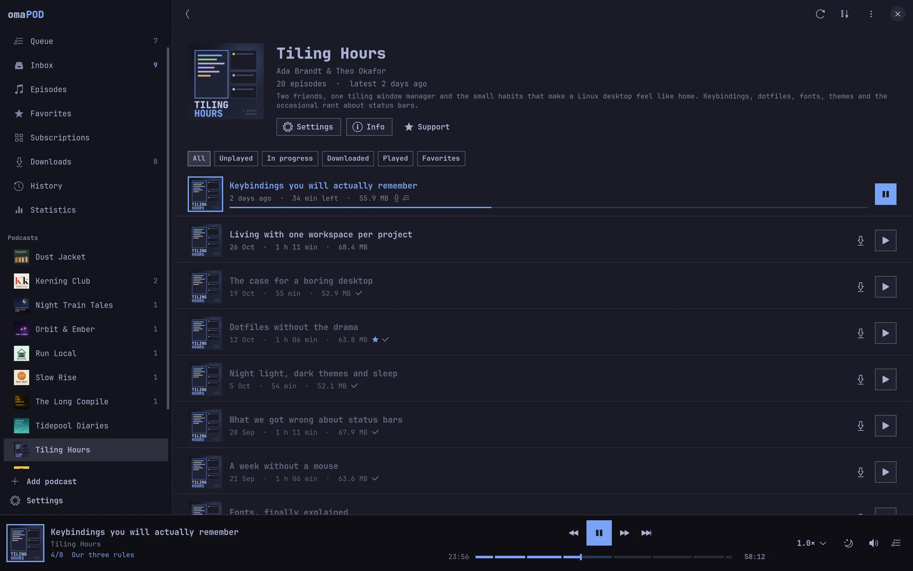
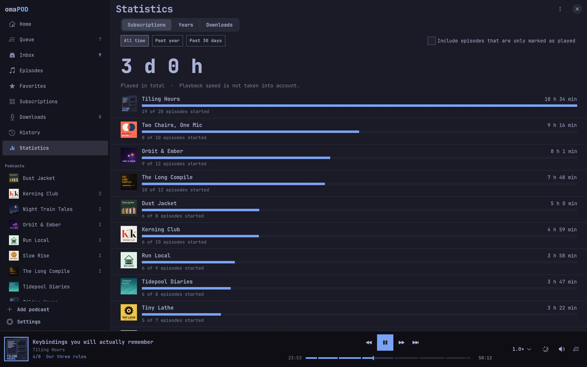
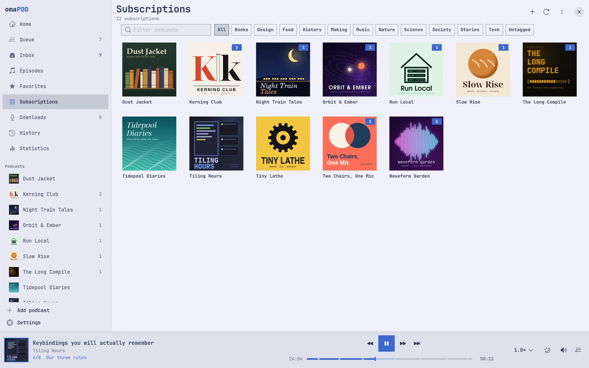
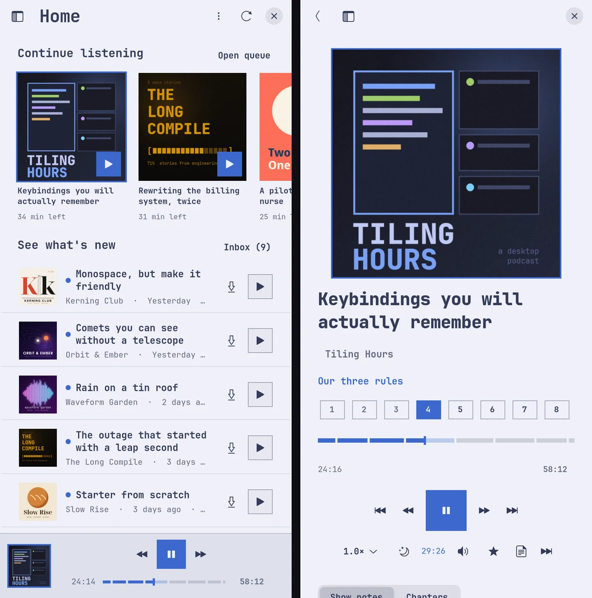
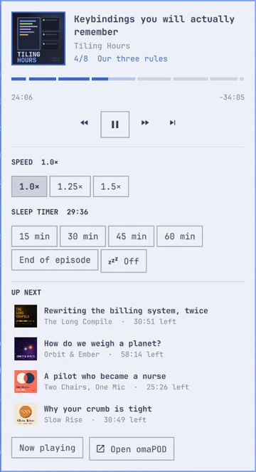

# omaPOD



A podcast manager for [Omarchy](https://omarchy.org), modelled on [AntennaPod](https://antennapod.org).
It looks like part of your desktop, follows your Omarchy theme live, and keeps your phone and your
computer in sync through the same servers AntennaPod uses.

- **Desktop app** (GTK4/libadwaita, Python): subscriptions, inbox, queue, downloads, playback, statistics.
- **Bar widget** for the Omarchy shell: what is playing, chapters, speed, sleep timer and what comes next.
- **Sync** with AntennaPod via **Nextcloud GPodder Sync** or **gpodder.net** (also self-hosted).

> Status: 0.1, in active development. It is used daily by its author; expect rough edges.

## Features

AntennaPod's feature set, adapted to a keyboard-and-mouse desktop:

| Area | What omaPOD does |
|---|---|
| Subscribing | Search Apple Podcasts, fyyd, gpodder.net or Podcast Index (own API key); top podcasts per country; add by RSS address (websites are searched for their feeds); preview before subscribing; OPML import; local folders as podcasts; `podcast://`, `itpc://`, `feed://` links |
| Library | Home (continue listening, new, surprises, classics, downloads), Queue, Inbox, Episodes with filters, Favorites, Downloads with download log, History, Subscriptions grid or list with tags, counters, sorting and an archive |
| Podcasts | Info with funding links, rename, tags, archive, unsubscribe, edit feed URL, refresh the complete (paged) feed, mark all as played, password-protected feeds |
| Per-podcast settings | Keep updated, new episodes action (inbox, queue, nothing), auto download with include/exclude terms and minimum length, delete after playing, playback speed, skip silence, skip intro and ending, volume adaptation, notifications |
| Playback | Streaming or downloaded files through mpv, resume positions, speed presets, skip silence (positions stay exact), volume boost, sleep timer (time, end of episode, extend, auto-enable at night), continuous playback, smart mark as played, chapters (Podlove, Podcasting 2.0 JSON and chapters in the file), transcripts (SRT, WebVTT, JSON, HTML), clickable timestamps in show notes, video podcasts in an mpv window |
| Downloads | Parallel downloads with resume, automatic download with an episode limit, cleanup rules (after finishing, hours/days later, when not in queue, when not favorited), delete removes from queue, download when not charging |
| Desktop | MPRIS (media keys and Omarchy's media widget), notifications for new episodes and failures, keyboard shortcuts, runs in the background while playing, hourly background refresh when closed (optional systemd timer) |
| Sync | Subscriptions and episode actions with AntennaPod's own rules (remote positions only win when they are newer, the first sync uploads your played episodes); continue where the phone stopped; downloads of other devices; queue and favorites shared between omaPOD computers |
| Backup | Database export and import, automatic backups every 3 days, OPML and HTML export, favorites export |
| Statistics | Time played per podcast and per month, storage per podcast |
| Language | English and German |

Phone-only parts of AntennaPod (mobile data rules, shake to reset, widgets, Wear OS, Chromecast) are left out
or replaced by their desktop counterpart (bar widget, MPRIS, keyboard shortcuts, context menus instead of swipes).

| Home | Now Playing |
| --- | --- |
|  |  |

| A podcast | Statistics |
| --- | --- |
|  |  |

omaPOD follows your Omarchy theme live, light or dark, and every screen still works in a 360 × 420 tile.

| A light theme | Two narrow tiles |
| --- | --- |
|  |  |

The pictures show a made-up library.

## Install

omaPOD comes as one Omarchy plugin: the app and its bar widget. Install it from the Omarchy plugin marketplace,
or with:

```bash
omarchy plugin add https://github.com/arikisonfire/omapod --enable
```

The widget appears in the bar; click it to start omaPOD. It needs `python`, `python-gobject`, `gtk4`, `libadwaita`
and `mpv`, which Omarchy ships.

Optional extras: an entry in the app launcher, `podcast://`, `itpc://`, `pcast://` and `antennapod-subscribe://`
links (unless you picked another app for them) and, with `--timer`, an hourly refresh while omaPOD is closed:

```bash
~/.config/omarchy/plugins/io.github.arikisonfire.pod/install.sh --timer
```

**Update** with `omarchy plugin update io.github.arikisonfire.pod`. A running omaPOD keeps its version and says
when a newer one waits for a restart.

**Remove** the extras first, then the plugin. Your library stays in `~/.local/share/omapod` and
`~/.config/omapod`:

```bash
~/.config/omarchy/plugins/io.github.arikisonfire.pod/install.sh --uninstall
omarchy plugin remove io.github.arikisonfire.pod
```

Without the marketplace, `./install.sh --plugin` in a copy of this repository installs the app and a copy of the
bar widget, `--link` runs it straight from there (for development), and `--uninstall` removes both. Installing
or updating the widget this way makes the Omarchy shell reload all of its plugins, so the installer asks first.

## Sync with AntennaPod

Use the same account in both apps.

- **Nextcloud**: install the *GPodder Sync* app on your Nextcloud. In omaPOD open Settings → Synchronization →
  Nextcloud, enter the address and grant access in the browser window that opens.
- **gpodder.net**: Settings → Synchronization → gpodder.net, enter server, username and password, then pick or
  create a device.

The first sync uploads your subscriptions and played episodes; after that only changes travel.

What travels between omaPOD and AntennaPod is what AntennaPod synchronizes: subscriptions, playback positions and
the played state (finished episodes also leave the queue and the inbox on the other device). omaPOD adds:

- **History**: like AntennaPod's own, it lists every episode you played, finished or not, by when you last heard it
  on whichever device.
- **Continue where another device stopped**: if you listened on your phone more recently, the player gets that
  episode ready at the same position. Before playback starts, omaPOD asks the server for the latest positions, so
  you can switch devices mid-episode. AntennaPod uploads about 20 seconds after you pause, later when it waits
  for Wi-Fi.
- **The other way round**: omaPOD uploads the position a few seconds after you pause and when you quit. AntennaPod
  fetches it when it starts (at most every 10 minutes) and right after you refresh by pulling down a list. If
  AntennaPod still has the episode loaded in its player, it continues from its own last position instead
  ([AntennaPod issue #5444](https://github.com/AntennaPod/AntennaPod/issues/5444)); closing AntennaPod completely
  first avoids that.

AntennaPod sends neither its queue nor its favorites, so those cannot come from the phone. Two extras go further:

- **Downloads on other devices**: Downloads → On other devices lists what AntennaPod or another omaPOD downloaded
  and is not downloaded here, with a button to fetch it. Optionally (Settings → Synchronization) omaPOD downloads
  it right away, unless it is played; deletions stay on each device. With Nextcloud this needs a GPodder Sync
  version that keeps download reports: 3.18 and older discard them.
- **Share queue and favorites between computers** (Nextcloud): computers running omaPOD keep the same queue
  and favorites through two files in the hidden folder `.omapod` of your Nextcloud. The queue follows the most
  recent change, favorites are merged.

## Privacy and security

omaPOD has no telemetry, crash reporting or update check. It talks to the podcast hosts you subscribe to and the
hosts their feeds point to, to the search directory you use (Apple Podcasts by default, which also supplies the
top list on **Add podcast** unless you hide it) and to your sync server. The sync server learns your
subscriptions, what you played and a device name made from your computer's host name.

Your library, settings and secrets stay in your home folder, readable by your user only. Sync logins, the proxy
password and the Podcast Index key are kept apart from the settings in `~/.config/omapod/credentials.json`;
passwords of protected podcasts are part of the library, and so of database exports and backups. The password of
a protected podcast goes only to that podcast's server.

[SECURITY.md](SECURITY.md) lists every file, connection and what other programs can see, and how to report a
vulnerability.

## Bar widget

The bar shows the episode that is playing with a thin progress line in your theme's accent. The popup has the
cover, chapters as segments, rewind/play/forward/skip, speed presets, the sleep timer and the next episodes in the
queue. Left click opens the popup, middle click plays or pauses, right click opens omaPOD, scrolling seeks. While
the app is closed, the widget offers to start it.



Settings, inline in the widget's entry in `~/.config/omarchy/shell.json`:

| Key | Default | Meaning |
|---|---|---|
| `showTitle` | `true` | Show the episode title in the bar |
| `maxTitleWidth` | `180` | Maximum title width in px |
| `hideWhenStopped` | `false` | Hide the widget when nothing is loaded |
| `launchCommand` | empty | Command that starts the app; empty starts the omaPOD that came with the widget, or the installed one |
| `socketPath` | empty | Control socket, for development copies of the app |

## Command line

```bash
omapod                      # start or raise the app
omapod ctl toggle           # play/pause (also: play, pause, rewind, forward, skip, seek 120, seek +30,
                            # speed 1.5, sleep 30, sleep-off, show, now-playing, state, quit)
omapod --refresh            # refresh, auto-download and sync without a window
```

Keyboard: Space play/pause, J/L rewind/forward, Ctrl+←/→ as well, Ctrl+P now playing, Ctrl+F search,
Ctrl+R refresh, Alt+1…6 screens, Ctrl+? all shortcuts.

## Development

```bash
python3 -B -m unittest discover -s tests -t .
OMAPOD_HOME=$PWD/.dev OMAPOD_MPV_AO=null python3 -m omapod   # isolated data, no sound
```

The repository is the plugin the marketplace installs: `manifest.json` names the widget in `plugin/`, and the
widget starts the app from the folder above it. Nothing may write into that folder while it is installed: every
new file there makes the Omarchy shell reload all plugins, so bytecode goes to `~/.cache/omapod/pycache`.

The tests use a local fake server for feeds, downloads and both sync APIs, and mpv's null audio output.
`tests.test_hardening` covers what a feed, a media host or a sync server could abuse: credentials, size limits,
local files, slow input and two processes at once. `tests.test_install` runs the installer in a throwaway home.
`tests.test_tiling` opens every screen in the smallest window and needs `xvfb-run` and `dbus-run-session`
(skipped without them).

## License

GPL-3.0-or-later. omaPOD is an independent project and not affiliated with AntennaPod; it reimplements
AntennaPod's behaviour in Python so both apps agree on your library.
